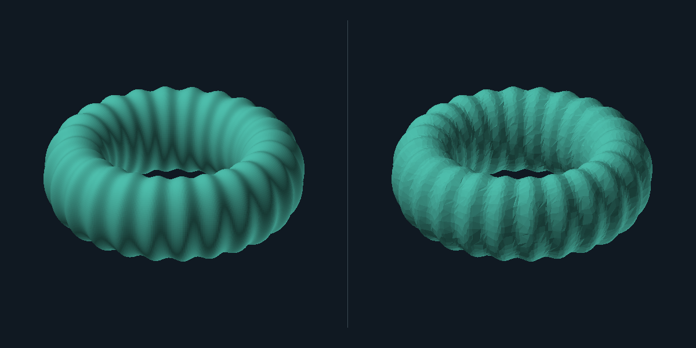

# Mesh to Play

**Turn a dense static prop into measured LOD candidates and a reviewable Unity handoff.**

Mesh to Play runs locally: a Python standard-library engine, a dependency-free browser workspace and the pinned open-source [meshoptimizer](https://github.com/zeux/meshoptimizer) simplifier. No account, paid API, model download, CDN or telemetry. Your original file is copied unchanged into the result bundle.



*Original procedural reactor shell and actual LOD2 export, rendered with the same camera, scale and flat geometry shading. This is a geometry comparison, not a browser screenshot or a textured appearance test.*

## Start locally

Requirements: **Python 3.10+**. Preparation also needs a local C++ compiler; inspection and the original demo do not. No Python packages are required.

```sh
# Compile the checked-in, checksum-pinned meshoptimizer source. No downloads.
python3 tools/build_native.py
python3 tools/build_native.py --check

# Open the local workspace in your browser.
python3 run.py serve
```

Windows: use `python` in an MSVC Developer Command Prompt, or provide a supported C++ compiler with `--compiler`. macOS: install Xcode command line tools. Linux: install a C++11-capable compiler such as `g++`. Native binaries are built on your machine and are not checked in. If the library is missing, the UI explains how to build it and inspection remains available.

The server prints its exact `http://127.0.0.1:PORT` address and binds only to loopback. Use `--no-browser`, `--port 8080` or `--workspace PATH` as needed. Keep the server in the foreground; stop it with Ctrl+C. Generated jobs remain in the chosen workspace until you explicitly clean them:

```sh
# Stop the server first. Removes generated job folders in this marked workspace.
python3 run.py cleanup --workspace .meshplay-jobs
```

## CLI

```sh
# Make the original 131,072-triangle demo.
python3 run.py demo --out results/demo

# Inspect without a native library.
python3 run.py inspect results/demo/original-reactor.glb --out results/inspection

# Prepare three independently simplified candidates from the original geometry.
python3 run.py prepare results/demo/original-reactor.glb --out results/prepared \
  --ratios 0.5,0.25,0.1 --error 0.01

# Optional: uniformly set the LONGEST dimension to 2 meters and move the pivot.
python3 run.py prepare asset.glb --out results/scaled \
  --height 2 --bottom-center
```

Each output directory must be new. Existing directories and input files are never overwritten. `LOD0` is the first reduced candidate, not the dense original. Ratios must be three strictly decreasing numbers between zero and one. `--error` is the simplifier's relative per-primitive error bound; seams, material boundaries and topology can stop a candidate above its requested count. Requested and achieved counts are both reported. Each primitive target is floored to an integer with a minimum of one triangle, including for very small ratios.

Library discovery is explicit `--native-library PATH`, then `MESHOPT_LIBRARY`, then this checkout's `native/` build. No arbitrary system or Blender library is loaded.

## Actual demo measurements

Measured on macOS using the pinned native source and the default settings. Every exported GLB was parsed again for its measurements. These are one original model's results, not a performance or quality promise for other assets.

| File | Triangles | Vertices | Bytes | Triangle reduction |
|---|---:|---:|---:|---:|
| Original reactor | 131,072 | 66,177 | 3,691,664 | — |
| LOD0.glb | 65,536 | 33,281 | 1,852,632 | 50.0% |
| LOD1.glb | 32,768 | 16,809 | 932,308 | 75.0% |
| LOD2.glb | 13,106 | 6,798 | 376,036 | 90.0% |

Original SHA256: `083dcdcb9bd0d64aff160a07bfed067c8dd1429d22fc5d64f48f06e9279bb03a`.

See [the actual structured report](examples/reactor-report.json) and [reproduction notes](examples/README.md). The demo is authored procedurally by this project; no external model license or AI service is needed. A small cube can show no useful reduction under a strict error bound; that is a valid result.

## What you receive

- `LOD0.glb`, `LOD1.glb`, `LOD2.glb` when preparation succeeds: standard uncompressed, embedded GLB files. All supported vertex streams are compacted with one remap per primitive. Materials and embedded PNG/JPEG bytes are copied.
- `source.glb` or `source.obj`: the unchanged original upload; its SHA256 is recorded.
- Complete world-coordinate `before.msh` and `after.msh` geometry previews. After shows LOD0; no preview subset is substituted.
- `report.json` and a standalone escaped `report.html`: geometry, dimensions, requested/achieved budgets, per-primitive native error, settings and limitations.
- `checksums.json`: payload and report SHA256 values. `bundle.zip` includes reports, source, candidates, previews and the Unity helper. `bundle.zip.sha256` hashes the ZIP wrapper separately; no checksum includes itself.
- A [Unity Editor LODGroup builder](integrations/unity/README.md). Install the official **`com.unity.cloud.gltfast`** package to import GLBs. Unity execution has not been verified.

## Supported inputs and limits

**GLB 2.0:** one embedded uncompressed buffer; indexed or non-indexed triangle primitives; multiple primitives and nodes; selected scene; parent transforms and mesh instances; negative/nonuniform scales; interleaved accessor strides; float attributes and normalized unsigned UV/color streams. Positions/normals/tangents use valid float stream types; custom attributes require FLOAT to avoid integer-ID rounding. Embedded images must use PNG/JPEG buffer views. World transforms are baked into output geometry, mirrored winding is corrected and normals use the inverse transpose. Only triangle-referenced vertices determine dimensions, scale and previews; unused vertex slots are removed with one remap for all streams and their count is reported. The source bytes remain unchanged.

**OBJ:** UTF-8 single-file triangle geometry with positive or negative position/UV/normal indices. External `mtllib` and `usemtl` are never loaded; a visible report warning identifies geometry-only material handling. Polygon faces, extra vertex components and mixed missing face attributes are rejected; triangulate first. OBJ units are unknown until you explicitly choose a scale.

Limits: 64 MiB input, 2 million expanded vertices, 2 million triangles, 4,096 nodes, hierarchy depth 128 and 16 million cumulatively decoded accessor scalars. Preparation supports at most 32 non-position scalar attributes per vertex with finite magnitude at most 1,000,000. Zero-size primitives and singular transforms are rejected for preparation. Inputs exceeding supported limits fail with an explanation. These limits bound work; they are not a promise that every large asset fits a browser or engine memory budget.

Unsupported inputs are rejected: skins, animation, morph targets, sparse accessors, non-triangle modes, geometry compression, required extensions, external resources, camera-bearing scenes and unsupported document/node/mesh extensions. No URLs or referenced files from an uploaded model are fetched.

## Review the result

The browser displays flat geometry inspection shading, not a physically accurate textured render. Embedded textures are preserved, not rebaked, resized or tested for visual equivalence. Geometry reduction does not imply reduced draw calls, smaller textures, improved FPS, watertightness or collision readiness. Check silhouette, hard edges, UV seams, materials and shading in your target engine. No rigging, retopology service, texture atlas, convex decomposition or collider generation is included.

## Implementation and verification

- [`meshplay/formats.py`](meshplay/formats.py): bounded static parsers, world transforms and GLB writer.
- [`meshplay/native.py`](meshplay/native.py): exact ctypes signature, validation and stable normalization before native calls.
- [`meshplay/pipeline.py`](meshplay/pipeline.py): shared processing, original demo, measurements, reports and bundle.
- [`meshplay/server.py`](meshplay/server.py): Host/Origin checks, per-process token and registered artifact routing. One worker subprocess runs at a time, at most three jobs are outstanding and eight jobs are accepted per session. Workers have a 180-second wall limit and platform-supported resource limits. Upload parsing and HTTP concurrency are bounded.
- [`web/`](web/): original browser interface; no external frontend runtime.
- [`third_party/meshoptimizer/UPSTREAM.json`](third_party/meshoptimizer/UPSTREAM.json): exact upstream revision and file checksums. Simplification is credited to meshoptimizer; inspection, formats, integration and workflow are this project's code.

Run the meaningful local gates:

```sh
python3 tools/build_native.py --check
python3 -m unittest discover -s tools -p 'test_*.py' -v
python3 -m unittest discover -s tests -v
node --test
```

Tests cover malformed accessor bounds and strides, normalized/interleaved streams, embedded texture byte preservation, transforms/reflections, cycles, unsupported features, export compaction, real detailed-mesh reduction, original preservation, invalid options, token/origin policy, traversal, actual worker subprocesses and in-memory HTTP routes. The development sandbox denied socket binding (`Operation not permitted`); no live HTTP/browser end-to-end claim is made from that environment. The Linux/macOS/Windows GitHub Actions workflow is provided; its remote results must be checked after publication. Unity remains unexecuted.

## License

Original code and demo generator: [MIT](LICENSE). Vendored meshoptimizer retains [its upstream MIT license](third_party/meshoptimizer/LICENSE.md). Unity glTFast is a separate dependency installed in your Unity project; consult its license and package requirements.
